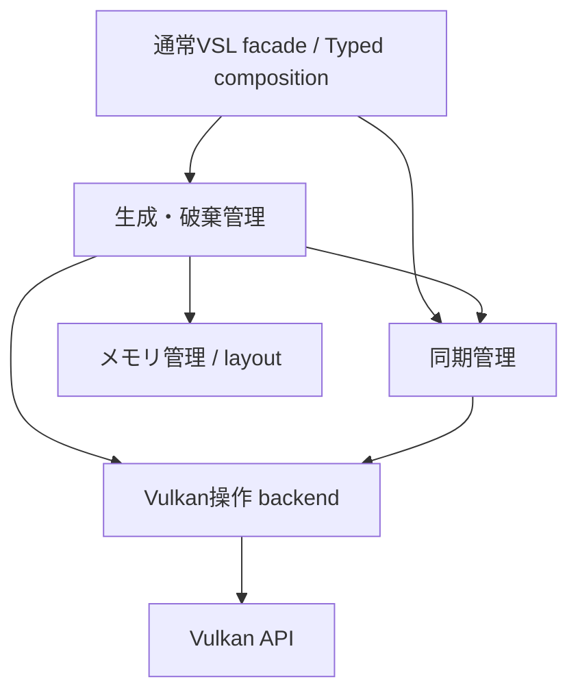

# VSLの責務・所有・Impl配置の再設計案

状態: **当初設計と調査時点の事実を保存した文書**。2026-10-31。後続の最初の移行単位は実装済みで、採用したAPI・差分・検証は[Buffer配置の実装](buffer-placement.md)を参照する。以下の「現checkout」「未実装」は設計調査時点を指し、当該コードの根拠リンクは固定commitへ向ける。

移行順・最初の実装範囲・検証の受入条件は[移行計画](ownership-migration-plan.md)を参照する。以下のAPI名・ディレクトリ名は仮案であり、責務と契約を先に合意する。

## 1. 調査基点と資料の扱い

主たる根拠は作業ディレクトリのHEAD **`233717c6f5df9a21f97ba50c8d271530ef679b85`**。ローカルmasterは後続履歴より古く、`AHOLi/CMakeLists.txt`には利用者の未コミット変更がある。checkout・rebase・その変更の編集はしていない。

このcheckoutでは以下に注意する。

- リポジトリの指示ファイルは`AGENT.md`。`AGENTS.md`は検索した範囲にない。会話で提示された日本語・C/C++向けの指示も適用する。
- 指定された`documents/typed-stack.md`はHEADにはなく、同じ設計系列の資料は[documants/typed-stack.md](https://github.com/aruzen/AHO/blob/233717c6f5df9a21f97ba50c8d271530ef679b85/documants/typed-stack.md)にある。後続の文書移動は別の事実として確認した。
- `ResourceUseState`／`ResourceUseGroup`、AHO Typed adapter、resource bundle／allocation planはHEADにはない。調査から除外せず、**補足基点B**のコードを確認した。HEADに存在する機能とは表現しない。

| 基点 | 内容と利用範囲 |
| --- | --- |
| A: checkout `233717c6` | Buffer／Accessor／Impl、Typed buffer・view・command、Completion／Phase、AHO Buffer。現状説明の既定の根拠 |
| B: 確認時のorigin/master `8959e5bf701677799b484999c4f55bcbdb5e9530` | ResourceUse系列、TypedResourceBundle／ResourceAllocationPlan、AHO Typed adapter、`documents/`への資料移動。これらの後続機能の意味を維持するための補足 |
| C: StoragePolicy作業branch `a09a2fd38524d1d34966863a983a64d198e40ee0` | PR #307の生成型・factory差し替え案。Bには未反映。これだけでImplの配置・所有が変わるとは扱わない |

補足コードは固定commitで参照する。

- [B: Typedのstack](https://github.com/aruzen/AHO/blob/8959e5bf701677799b484999c4f55bcbdb5e9530/documents/typed-stack.md)
- [B: resource use](https://github.com/aruzen/AHO/blob/8959e5bf701677799b484999c4f55bcbdb5e9530/VSLi/VSL/src/vulkan/resource_use.cpp)
- [B: resource allocation](https://github.com/aruzen/AHO/blob/8959e5bf701677799b484999c4f55bcbdb5e9530/VSLi/VSL/include/VSL/utils/typed_resource_allocation.hpp)
- [B: resource bundle生成](https://github.com/aruzen/AHO/blob/8959e5bf701677799b484999c4f55bcbdb5e9530/VSLi/VSL/include/VSL/utils/typed_resource_bundle_detail.hpp)
- [B: AHO Typed adapter](https://github.com/aruzen/AHO/blob/8959e5bf701677799b484999c4f55bcbdb5e9530/AHOLi/AHO/include/AHO/resource/typed_buffer.hpp)
- [C: StoragePolicy](https://github.com/aruzen/AHO/blob/a09a2fd38524d1d34966863a983a64d198e40ee0/VSLi/VSL/include/VSL/utils/typed_resource_storage.hpp)

資料は[Accessorの設計](Accessorの設計パターンについて.md)、[commandの資源寿命](command-resource-lifetime.md)、[descriptorの所有権](descriptor-ownership.md)、[Phaseの寿命](phase-lifecycle.md)、[buffer転送](buffer-transfers.md)、[Typed frame resources](https://github.com/aruzen/AHO/blob/233717c6f5df9a21f97ba50c8d271530ef679b85/documants/typed-frame-resources.md)を照合した。資料の過去の検証結果を今回の実行結果には数えない。

## 2. 目的と今回の決定案

主目的はライブラリの責務と依存関係を整理し、通常VSLとTypedが**同じ実体構築・Vulkan操作を、異なるCPU配置・所有方法で使える**ようにすること。

| 決定案 | 内容 |
| --- | --- |
| D1 | CPU領域の割当、native操作、生成／破棄の判断、同期の判断を分ける |
| D2 | Implは配置先に構築可能な実体とする。native破棄を呼ぶタイミングをImplのshared_ptrカウントに埋め込まない |
| D3 | 通常操作には構築済みImplの借用参照を渡す。毎操作のslot検索・型レジストリ解決・owner検索を必須にしない |
| D4 | arena内部の依存は借用。外部公開handle・command・送信の境界で所有者を保持する |
| D5 | slotの意味上の識別子とImplの種類を分ける。同じ型の複数実体を型名だけで識別しない |
| D6 | privateな実定義からtarget compilerでsize／alignmentを生成する。公開ヘッダーは定数・opaque参照だけを持つ |
| D7 | CPU Impl領域、内部コンテナ、GPUメモリを別々に計画・計測する |
| D8 | 再確保は新しいstorage世代を作る。旧viewを新storageへ暗黙に付け替えない |
| D9 | descriptorは更新可能なbinding状態を持ち、記録時点の参照を使う。使用中の更新禁止を保つ |
| D10 | GPU保持とアクセス同期は別契約。所有者のpinだけで読み書き・可視性を保証しない |

個別確保・多段参照・参照カウント操作を減らせる可能性はあるが、**性能向上は未測定の仮説**。virtual呼び出しやshared_ptrが存在するだけで実際のボトルネックとは判断しない。TypedBatchの固定容量plan・bind削減など、既にある静的情報の利用は残す。

## 3. 現在の経路と変更箇所

### 3.1 Bufferの構築と破棄【事実A】

根拠: [buffer.hpp](https://github.com/aruzen/AHO/blob/233717c6f5df9a21f97ba50c8d271530ef679b85/VSLi/VSL/include/VSL/vulkan/buffer.hpp)、[buffer.cpp](https://github.com/aruzen/AHO/blob/233717c6f5df9a21f97ba50c8d271530ef679b85/VSLi/VSL/src/vulkan/buffer.cpp)、[buffer_and_image_accessor.hpp](https://github.com/aruzen/AHO/blob/233717c6f5df9a21f97ba50c8d271530ef679b85/VSLi/VSL/include/VSL/vulkan/buffer_and_image_accessor.hpp)、[_pimpls.hpp](https://github.com/aruzen/AHO/blob/233717c6f5df9a21f97ba50c8d271530ef679b85/VSLi/VSL/include/VSL/vulkan/_pimpls.hpp)。

```text
Buffer<usage, properties> constructor
  -> BufferAccessor::MakeBuffer
     -> make_shared<BufferImpl>
     -> device shared_ptrを格納
     -> createBuffer
     -> getBufferMemoryRequirements / memory type選択
     -> allocateMemory / bindBufferMemory
  -> BufferAccessor::data_ がImplを共有所有

最後のImpl所有者の解放
  -> BufferImpl::~BufferImpl
     -> unmapMemory（mappedなら）
     -> destroyBuffer
     -> freeMemory
```

`MakeBuffer`がCPU割当・Vulkan生成・GPUメモリの方針・依存所有をまとめている。`BufferImpl`はdeviceを強く所有し、native handle・要求byte数・実allocation size・usage／properties・mapping・nonCoherentAtomSizeを保持する。`BufferAccessor`は名前に反して借用だけの型ではなく、公開`data_`が`shared_ptr<BufferImpl>`である。

構築途中のnative handleも既存Implのデストラクターで回収する経路になっている。ただし「失敗した全段階の巻き戻しを今回実行検証した」という意味ではない。新設計では失敗段階を明示し、注入テストで契約化する。

mappingはImplと共有する。`LocalBufferHolder`は`parent`生ポインターを互換用に残すが、内部操作には自身の`_owner`を使い、元wrapperより長生きできる。holder破棄ではunmapしない。flush／invalidateは実memory propertiesとatom境界を参照する。

### 3.2 Typed bufferとview【事実A】

根拠: [typed_vertex_buffer.hpp](https://github.com/aruzen/AHO/blob/233717c6f5df9a21f97ba50c8d271530ef679b85/VSLi/VSL/include/VSL/utils/typed_vertex_buffer.hpp)、[typed_resources.hpp](https://github.com/aruzen/AHO/blob/233717c6f5df9a21f97ba50c8d271530ef679b85/VSLi/VSL/include/VSL/utils/typed_resources.hpp)、[typed_pipeline.hpp](https://github.com/aruzen/AHO/blob/233717c6f5df9a21f97ba50c8d271530ef679b85/VSLi/VSL/include/VSL/utils/typed_pipeline.hpp)。

- Typed bufferはpayload・usage・record数を持つが、内部では通常のVSL Bufferを生成する。CPU上のImpl配置は指定できない。
- vertex viewは`shared_ptr<BufferImpl>`とoffset／count、resource viewは所有者を含むDescriptorValueとoffset／countを持つ。viewは取得時のstorageを保持する。
- descriptor更新はnative setへ書き、`GraphicResourceImpl::bindings`がbindingごとのbuffer／image／sampler所有者を保持する。同じbindingの置換は古い所有者を解放する。
- TypedDrawは既存GraphicsPipeline・bind commandを保持する。descriptor set数が型で分かっていても、resource commandはvectorで保持する。

このため、schemaから論理構成を計算できても、そのままImplのCPU配置計画へ渡す経路がない。

### 3.3 AHO Bufferと再確保【事実A、接続はB】

根拠: [AHO buffer.hpp](https://github.com/aruzen/AHO/blob/233717c6f5df9a21f97ba50c8d271530ef679b85/AHOLi/AHO/include/AHO/resource/buffer.hpp)、[buffer.cpp](https://github.com/aruzen/AHO/blob/233717c6f5df9a21f97ba50c8d271530ef679b85/AHOLi/AHO/src/resource/buffer.cpp)、[BufferUpload](https://github.com/aruzen/AHO/blob/233717c6f5df9a21f97ba50c8d271530ef679b85/AHOLi/AHO/src/command/buffer_upload.cpp)。

```text
AHO Bufferのコピー
  -> 同じBufferState（論理サイズ・現在のResource）
     -> BufferResource<Storage, Customization>
        -> optional<Storage> / optional<Mapping> / Customization
           -> VSL Buffer -> shared_ptr<BufferImpl>
```

GENERALは共有vector。GPU系はStorage／Customizationの具体型を保持する。`reserve`等による置換は、新しいResourceを生成・検証し、必要なら内容をコピーしてから共有stateのnative参照とresourceを変更する。mapping・Storage・Customizationの破棄順も既存の契約である。CPUの生ポインター・spanの安定性は再確保をまたいで保証しない。

AHOの`BufferBinding`は共有stateを見ており、BufferUploadはinvoke時に現在のnativeを解決する。これは**取得時の実体を保持するTyped viewとは異なる意味**。BのAHO Typed adapterは実storageのsnapshotをviewへ渡し、ResourceUseにCustomの所有者も付ける。

新設計では「論理Bufferの現在値を参照するbinding」と「特定世代のstorage view」を別の契約として保つ。両方を単一のraw pointerへ置き換えてはならない。

### 3.4 commandからsubmissionまで【事実A】

根拠: [command.hpp](https://github.com/aruzen/AHO/blob/233717c6f5df9a21f97ba50c8d271530ef679b85/VSLi/VSL/include/VSL/vulkan/command.hpp)、[command.cpp](https://github.com/aruzen/AHO/blob/233717c6f5df9a21f97ba50c8d271530ef679b85/VSLi/VSL/src/vulkan/command.cpp)、[phase.cpp](https://github.com/aruzen/AHO/blob/233717c6f5df9a21f97ba50c8d271530ef679b85/VSLi/VSL/src/vulkan/phase.cpp)、[CopyBuffer](https://github.com/aruzen/AHO/blob/233717c6f5df9a21f97ba50c8d271530ef679b85/VSLi/VSL/src/vulkan/commands/copy_buffer.cpp)、[BindVertexBufferAt](https://github.com/aruzen/AHO/blob/233717c6f5df9a21f97ba50c8d271530ef679b85/VSLi/VSL/src/vulkan/commands/bind_vertex_buffers.cpp)。

- CopyBufferは作成時にsource／destinationのImplを強く保持する。BindVertexBufferAtもImpl所有者を取得する。一方、旧BindVertexBuffer等にはwrapperの生ポインターをinvokeまで借用する経路がある。
- invokeはdevice・範囲等を検証し、`CommandBuffer::retain`を通して記録中のSubmissionImplへ所有者を渡してからnative commandを記録する。
- `SubmissionImpl::resources`は`vector<shared_ptr<void>>`。Completionとframe slotがSubmissionImplを保持する。送信中のSubmissionImpl破棄はfenceを待つ。
- `Completion::wait`／`ready`で完了してもresources自体は直ちにはclearされない。古いCompletionを保持すれば資源も残る。slot再利用は前の送信を待ってから置き換える。
- Phase外の手動記録で`CommandBuffer::retain`しても、記録中submissionがなければ保持は追加されない。
- ComputePhaseのcancelはCANCELLEDにし、記録中submissionとの接続を外す。Completionが残れば保持も残る。DefaultPhaseのcancelには取得画像を返す処理があり、単なるCPU参照解放にはできない。

したがって、GPU完了だけを考えたarena ownerでは不十分。**command作成→invoke**、**記録→送信または取消**、**送信→GPU完了**をそれぞれ覆う必要がある。

### 3.5 使用状態・bundle・allocation plan【事実B】

- ResourceUseStateは使用中submissionをweak参照で追跡する。`mark_used`はPENDINGを要求し、複数の記録を追跡できる。`require_idle`と、別Phaseの使用を拒否する`check_available`は別の入口。
- ResourceUseは使用状態と実資源ownerの組。recordでownerをsubmissionへretainし、stateに使用を登録する。
- ResourceUseGroupはdescriptor自身の使用状態と、各bindingのResourceUseを持つ。**bind用command作成後のdescriptor更新も、record時点のbindingから追跡する**。単にbindを省略した場合もtrackは必要。
- CompletionObservationはsubmissionをweak参照し、terminal結果を別に保持する。frameやstateからsubmissionへの強参照循環を避けるための仕組み。
- ResourceAllocationPlanはbuffer数・descriptor数・論理payload byte数を計算する。CPU Impl size／alignmentやGPU memory requirementsは含まない。
- TypedResourceBundleはshared state、frameごとのstorage、setを構築する。TypedFrameResourcesはvector内の各Frameをmake_sharedし、Phaseへ保持させる。Impl自身は引き続き個別の所有経路で生成される。
- CのStoragePolicyは生成するwrapper型・factoryを選ぶ段階であり、既存Implの配置・device所有・native破棄の責務を分ける実装ではない。

### 3.6 文書と実装の差

Typed stackの「同期・使用中descriptor更新は利用側の責任」は過去の段階の説明であり、BではResourceUseによる更新拒否が追加されている。AにもAHO transfer用のbusy検査はあるが、VSL Typed全体のResourceUseと同一ではない。また、一般の使用状態追跡がbarrierや画像layoutを自動推論しているわけでもない。

Accessor資料の非virtual・コピーコストに関する一般的な説明も、全オブジェクトにそのまま当てはめない。現BufferAccessorにはvirtualなdata／flush／destructorがあり、shared_ptrコピーには所有管理が伴う。今回の設計判断は実コードの責務と契約を根拠とし、そのコストの大きさは測定課題とする。

この設計の実装着手時には、採用するbaselineへBの既存機能を反映し、二重実装を避ける。資料の文章だけで保証を判定しない。

## 4. 四つの責務と依存方向【提案】

| 責務 | 管理すること | 管理しないこと |
| --- | --- | --- |
| メモリ管理 | CPU Regionの確保・alignment・slot配置・容量・再利用・返却。GPU allocatorを設ける場合はallocation方針・lease | GPU完了の判定、vkCmd、bufferの意味 |
| Vulkan操作 | Implへのnative生成・map／flush／invalidate・update・command記録・native破棄。失敗時のその操作内のnative回収 | CPU領域の選択、shared ownership、いつ破棄可能かの判断 |
| 生成／破棄管理 | 構築順・依存DAG・rollback journal・OwnerControl・external owner・command／submission保持・破棄時期 | barrierの正しさ、fence完了を独自に推測すること |
| 同期管理 | 使用lease、host更新可否、アクセス順序、barrier計画、可視性、queue／completionの状態 | 資源やarenaの強い所有、CPU領域の返却、bufferのnative破棄 |

「Vulkan APIを呼ぶ」と「呼ぶべき時点を判断する」を分ける。`vkDestroyBuffer`を呼ぶのはbackend、呼出時点を決めるのは生成／破棄管理。fenceの結果は同期管理が提供する。`vkAllocateMemory`／`vkFreeMemory`も具体的呼出しはbackend、allocation方針とleaseの返却はメモリ管理、資源使用後に返却できる時点は寿命管理が判断する。



backendはarena・OwnerToken・ResourceUseGroup・上位wrapperへ依存しない。同期管理はnative barrier／fence操作をbackendへ依頼するが、backendが同期管理を呼び返して所有者を探す形にはしない。メモリ管理のCPU部分はVulkanに依存しない。

### 4.1 共有データの契約

| 仮称 | 内容・所有・利用時点 |
| --- | --- |
| ImplKind / ImplLayout | Implの論理種別とsize／alignment／ABI識別。構築・計画時だけ利用 |
| SlotKey / SlotDescriptor | 意味上の識別子とoffset／size／alignment／generation／状態。Impl種別とは別 |
| BufferRef / DeviceRef | opaque Implへの**借用**参照。構築・device検証済み。操作中は有効なownerまたは明示scopeが必要 |
| BufferSliceRef | BufferRef＋byte offset／range。storage世代を固定。所有しない |
| OwnerToken | arena全体またはheap実体を保持する境界用の型消去owner。初期実装はshared_ptrベースでよい |
| ResourceIdentity | owner domain ID＋slot ID＋generation。型やVkBufferの値だけで同一性を判断しない |
| UsageRef / UsageLease | 使用状態への借用と記録単位の登録。arena owner／submissionを強く所有しない |
| CompletionSignal | 送信固有の完了・取消結果。fence再利用後も過去結果を保存。保持resourceの一覧は持たない |
| RecordingRetention / InFlightRecord | owner集合・使用lease・CompletionSignalを組み合わせる**寿命管理側**のレコード |

初期段階のCPU並行操作は既存と同様に利用側で直列化する。atomic refcountがあってもslot構築・descriptor更新・queue操作の並行安全性は得られない。並行記録の拡張は後段で別途定義する。

### 4.2 Implの形

BufferImplはnative handle・mapping・範囲・properties・借用DeviceRef等を保持する。内部に`shared_ptr<LogicalDeviceImpl>`やarena自身のOwnerTokenを要求しない。deviceの外部所有者はOwnerControlが一度保持する。

native状態のデストラクター任せにせず、`destroy_buffer_native(BufferImpl&) noexcept`でunmap→destroyBuffer→memory lease返却に必要な処理を行い、その後`destroy_at`でC++実体を終える。CPUオブジェクト破棄とnative資源破棄を別の状態として扱う。将来GPU allocationを共有する場合は、bufferのnative破棄とlease最後の解放によるfreeMemoryを分ける。

privateなbackend内部では**解決済み`BufferImpl&`**を直接使う。公開された低水準借用APIから入る場合もopaque参照を一度渡すだけとし、毎操作のarena lookupは行わない。host書込の同期guardや範囲検査まで省く意味ではない。

## 5. CPU配置とサイズ情報【提案】

### 5.1 一括領域に含めるもの

| 領域 | 初期案 |
| --- | --- |
| BufferImpl等の配置可能なC++実体 | 含む。Implが持つvector等の**コンテナ本体**もsizeofの範囲で含む |
| slot状態表・構築順journal・UsageStateオブジェクト・内部依存表 | 数と容量をplanへ明示し、CPU領域に含める。型サイズがprivateなら同じlayout registryへ登録。UsageState内部の可変長uses要素は次行の扱い |
| OwnerControlと外部公開OwnerTokenのcontrol block | 領域外。領域全体の一つの所有境界。自身が所有する領域内へ自己ownerを埋め込まない |
| submission単位の保持・completionレコード | 初期は領域外の既存機構／adapter。後段で別poolを計画する |
| vector／map／string等の要素用heap確保、SPIR-V／reflection結果 | 初期は含めない。Implを一括配置してもこれらの確保は残る |
| mapped GPU payload、VkDeviceMemory、driver内部のdescriptor／pipelineメモリ | 含めない。CPU Impl配置とは別 |

「一括確保」は初期には**計画したCPU実体と管理表の一領域**を指す。全CPU allocationが一回になるとは言わない。後で内部可変長データも含める場合は、bounded span／allocator対応を個別に追加し、容量超過を暗黙heap fallbackで隠さない。

### 5.2 ImplKindとSlotKey

例: 同じBufferImpl型でも次は別slot。

```text
(role=buffer, scope=shared, set=2, binding=1, element=0)
(role=buffer, scope=frame, frame=0, set=2, binding=0, element=0)
(role=buffer, scope=frame, frame=1, set=2, binding=0, element=0)
(role=buffer, scope=shared, set=5, binding=0, element=1)
```

slotの識別は`role / scope / frame / set / binding / descriptor-array-element / ordinal`等の構造化keyで行う。SHAREDのframeを正規化し、setやpool等のbindingを持たない実体には別roleのkeyを使う。payload配列の各recordがBufferImplになるわけではない。descriptor配列の各owned bufferが別Implになる。

`ResourceSchema`はshader契約、AllocationSchemaは個数・scope、ImplLayoutはCPU実体寸法とする。device／command manager／descriptor pool等を既存ownerから借りるか新規に作るかもconstruction recipeに宣言する。schemaにない全engine内部資源まで推測して配置できるとはしない。

### 5.3 配置計算

```cpp
// 擬似コード。checked_add/multiply/align_upは全てoverflowを報告する。
cursor = 0;
required_alignment = 1;
for (slot : expanded_recipe) {
    layout = impl_layout(slot.kind, selected_abi);
    require(layout.size > 0 && valid_alignment(layout.alignment));
    offset = checked_align_up(cursor, layout.alignment);
    cursor = checked_add(offset, layout.size);
    required_alignment = max(required_alignment, layout.alignment);
    slots.add(slot.key, slot.kind, offset, layout);
}
total_size = checked_align_up(cursor, required_alignment);
```

slot表／journal／内部依存表等も`expanded_recipe`へ展開して計算する。固定schema・固定capacityならconsteval、frame数・runtime個数・容量を渡す場合は同じchecked計算を構築前に実行する。動的なcountと予約capacityは区別し、`live_count <= capacity`を要求する。

外部bufferはowned BufferImpl数に数えず、必要なimport表・依存保持容量は数える。pool数や内部作業領域は明示policyで確定する。driver次第で数が変わる部分を無根拠にconstexprへ入れない。CPU layout planと既存のlogical payload allocation planは名前・型を分ける。

領域の契約は以下。

- `Region{base, bytes, alignment}`をmemory providerから受け取る。over-aligned allocationと対応するdeallocationを対にする。
- offset／sizeの加算・countとの積・align-up・最終paddingのoverflowをすべて検査する。
- `offset <= bytes && size <= bytes-offset`を検証し、baseの実アドレスのalignmentも検証する。padding込みの容量を使う。
- 空planは0 byte・alignment 1・slot数0を許可し、nullに対してpointer算術やplacement newをしない。
- 同じregionを非trivialな実体ごとmemcpy／reallocして動かさない。成長時は新regionへ別世代を構築する。
- 再利用時は当該世代の全borrow利用scope・外部pin・GPU使用が終了していることを要求し、generationを更新する。generation wrapも拒否する。

### 5.4 private定義からの定数生成

第一候補は**target compilerによるcompile-only probe + 生成ヘッダー**。hostでtarget実行ファイルを起動してsizeofを表示させる方式を必須にしない。

1. private Impl定義と、それをコンパイルするABI条件を生成工程へ渡す。
2. CMake `CheckTypeSize`を`LANGUAGE CXX`・`CMAKE_TRY_COMPILE_TARGET_TYPE=STATIC_LIBRARY`で使う。
3. `sizeof(Impl)`に加え、`sizeof(char[alignof(Impl)])`を調べてalignmentを得る。target向け静的archiveに埋め込まれた検査結果をCMakeが読む。
4. 公開する`ImplLayout<ImplKind::BUFFER, AbiTag>`へ数値定数だけを生成する。利用側にImplの完全定義やVulkan-Hppのprivate includeを要求しない。
5. VSL本体の`layout_asserts.cpp`で実定義のsizeof／alignofとの**完全一致**をstatic_assertする。余裕サイズに収まればよい、という検査にしない。

```cmake
# 方針を示す抜粋。productionではconfig/arch別のisolated probeへ渡す。
set(CMAKE_TRY_COMPILE_TARGET_TYPE STATIC_LIBRARY)
set(CMAKE_EXTRA_INCLUDE_FILES "private/buffer_state.hpp")
check_type_size("vsl::impl::BufferImpl" VSL_BUFFER_SIZE LANGUAGE CXX)
check_type_size("char[alignof(vsl::impl::BufferImpl)]" VSL_BUFFER_ALIGN LANGUAGE CXX)
```

```cpp
// generated/impl_layout.hpp: 完全なImpl定義を含めない。
template<> struct ImplLayout<ImplKind::BUFFER, SelectedAbi> {
    static constexpr size_t SIZE = /* generated */;
    static constexpr size_t ALIGNMENT = /* generated */;
};
// VSL本体のprivate TU。
static_assert(sizeof(impl::BufferImpl) == BufferLayout::SIZE);
static_assert(alignof(impl::BufferImpl) == BufferLayout::ALIGNMENT);
```

[CheckTypeSizeの仕様](https://cmake.org/cmake/help/v3.30/module/CheckTypeSize.html)はCXX・追加include・検査用flags・architecture別の結果を扱う。[try_compile](https://cmake.org/cmake/help/v3.30/command/try_compile.html)はSTATIC_LIBRARYと生成物のCOPY_FILEを提供する。これらを組み合わせる提案であり、通常のVSL targetのPRIVATE設定を自動的に全部継承するわけではない。

### 5.5 ビルド条件と配布契約

| 条件 | 必要な扱い |
| --- | --- |
| target／ABI | OS、target triple、arch、pointer幅、compiler／標準library ABI、packing、例外／RTTI等の影響する設定、Vulkan-Hpp設定、SDK版、layout schema版を記録 |
| Debug／Release | config別にprobeする。MSVCのiterator debug level・CRT・packing等を含める。同じsizeでも同じABIとは推定しない |
| CMake | VSLとprobeのABI関連compile条件を共通INTERFACE設定に切り出して明示伝播する。C++26、sysroot、include、defines、config flagsを照合 |
| Multi-config | config別build dir／生成先／cache keyを使う。選択するヘッダーは実際にlinkするVSL binary variantと一致させる。単にconsumerのNDEBUGで選ばない |
| クロス | target compilerで静的archiveを作りhostで結果だけ読む。targetの起動・GPU・Vulkan loaderは不要。host compilerで代用しない |
| universal binary | archごとのsize／alignment／ABI IDを保持する。単一の最大sizeへ丸めない。最初の実装は単一archに限定し、未対応条件を明示拒否してよい |
| install | 生成header／manifest／binary／CMake exportを一つの配布単位にする。build-tree pathを埋め込まない |
| consumer | public定数とopaque参照だけを使う。採用ABIの配置対応targetをlinkし、別artifact由来の定数を混ぜない |
| MSBuild直実行 | 同じprobe手順に依存するcustom build targetが必要。対応前は通常Bufferだけを提供し、Typed配置機能を未対応として止める。古い数値を手書きしない |

現checkoutは`VSL STATIC`、CMake minimum 3.30／C++26。`_pimpls.hpp`はinclude配下にあり、`install(DIRECTORY ... include/)`で配布される。private定義を本当に非公開にするにはsrc/private等へ移し、install対象から外す変更が必要。既存publicヘッダーのinclude経路も棚卸しする。

root CMakeにはRelease用の`-march=native`等がある一方、Bではtarget単位設定／Windows経路／package整理が入っている。実装はその差を確認してから進める。現在のflagsをそのままクロス環境へ流用する案ではない。

生成の依存は`private state + bootstrap config -> probe -> generated layout -> assertions + library + consumer`とし、private stateがgenerated layoutをincludeする循環を作らない。private headerの変更、toolchain／config／ABI flagsの変更でprobeを再生成する。CheckTypeSizeの成功cacheを名前だけで永続再利用しない。

最初はconfigure時probeでよいが、その後のprivate header編集もconfigure再実行依存に登録する。設定ごとの結果が必要な場合はisolated sub-buildを利用する。型が増えてprobe時間が問題になれば、複数型を一度に測るcompile-only metadata生成へ移す。初期から独自object file parserを必須にしない。

### 5.6 ヘッダーとバイナリの整合性

size／alignmentのassertだけでは、古いconsumerが新しいbinaryとlinkしたときの不一致は防げない。

- generated manifestはlayout table、明示的ABI revision、private stateの内容／ABI設定のfingerprintからABI IDを持つ。
- 生成headerに対応したABI ID付きlink guardをVSL binaryが提供し、配置機能を使うconsumerから参照させる。違うartifactならlink時に拒否する。
- arena構築入口でもlibrary側のmanifestと期待IDを一度照合する。失敗したら領域へ構築する前に返す。毎copy／bindで照会しない。
- signature／実装上の意味が変わるのにsizeが同じ場合もABI revisionを更新する。生成数値を安定ABIと宣言しない。
- `VSL::Placement`等のopt-in targetで対応headerとbinaryを一緒に選択する。Multi-configのimport mappingも検証対象にする。

runtimeのlayout問い合わせは動的APIの補助・診断用に残せるが、constexpr Typed配置の代わりとして黙って使わない。

## 6. 共通backendを使うAPI案【提案】

### 6.1 構築入口

以下は責務を示す擬似APIであり、実装済みのsignatureではない。

```cpp
// public: Implはforward declarationだけ。
struct BufferRef { /* private: impl::BufferImpl* + identity */ };
struct BufferSliceRef { BufferRef buffer; size_t offset, bytes; };
struct StorageSlot { std::byte* address; size_t bytes, alignment; };

// lifetime layer。slot状態・ABI・依存を検査し、rollback journalを管理する。
BufferRef construct_buffer_at(ConstructionContext&, SlotId, StorageSlot,
                              const BufferCreateInfo&);

// private backend。CPU領域の確保・owner登録・待機はしない。
void initialize_buffer_native(impl::BufferImpl&, DeviceRef, const BufferCreateInfo&,
                              DeviceAllocationPolicy&);
void write_buffer_native(impl::BufferImpl&, ByteRange, std::span<const std::byte>);
void record_copy_native(NativeCommandBuffer, const impl::BufferImpl&,
                        impl::BufferImpl&, const CopyRegion&);
void destroy_buffer_native(impl::BufferImpl&) noexcept;
```

`ConstructionContext`はplan／region／journalを持つ。Typedが`base + slot.offset`から作ったStorageSlotを構築入口へ渡し、contextはSlotId・region・寸法との一致を検証する。slotへplacement newする関数はVSL側に置く。公開側のTypedは生成された寸法とoffsetを知るが、`sizeof(BufferImpl)`を直接使わない。

構築後は`base + slot.offset`からopaque BufferRefを得る。slotがliveか・型が合うかはresolve／外部公開境界で検査し、backend内部へ解決済み参照を渡す。通常操作を一律に`registry.find(id)`経由にしない。

### 6.2 通常BufferとTyped

```text
通常 Buffer constructor
  -> HeapObjectOwner + CPU memory provider
  -> construct_buffer_at(context, single_slot, heap_storage, info)
  -> initialize_buffer_native（共通）

Typed schema + capacities
  -> CpuObjectLayoutPlan
  -> ArenaOwner + 一つのaligned region
  -> 各slotへconstruct_buffer_at(context, id, slot_storage, info)
  -> initialize_buffer_native（同じ処理）
```

```cpp
// 通常APIの利用例は原則維持。
vsl::Buffer<usage, properties> buffer(device, bytes);
auto mapping = buffer.data();

// 新しいTyped配置経路の概念例。
auto plan = typed::make_cpu_layout<Allocation>(capacities, selected_layouts);
auto arena = typed::build_arena(plan, memory_provider, external_dependencies);
auto internal = arena.borrow_buffer<BufferKey>(); // arenaの有効scope内だけ
auto view = arena.export_buffer_view<BufferKey>(first, count); // ownerをpin
auto command = make_copy(view, external_destination.view(), region);
```

`borrow_buffer`の返す借用値をarena外へ保存してはならない。外部へ渡す安全なviewはBufferSliceRefとOwnerTokenを組み合わせる。内部のdescriptorやFrameがそのowning viewを格納して自己pinすることは禁止し、内部用のborrowed binding格納経路を使う。

低水準APIは所有者を探さず、lifetimeを保証したscope内でのみ使用する。通常Buffer／公開Typed APIがこの組合せを隠す。Vulkan APIを直接利用するescapeではnative handleと明示的なowner pinを別に取得できるようにする。

## 7. 所有グラフと寿命の契約【提案】

### 7.1 強い辺と借用の区別

```text
外部Buffer / owning view / command
  --strong--> OwnerControl
                --owns--> CPU region [Impl / UsageState / journal]
                --strong--> 外部DeviceOwner / imported owner domains

arena内 Impl --borrow--> 同arena内依存Impl / DeviceImpl
arena内 UsageState --weak/observation--> CompletionSignal

RecordingRetention / InFlightRecord --strong--> OwnerControl（domainごとに一回）
InFlightRecord --owns--> CompletionSignal
Managerのin-flight registry --strong--> InFlightRecord
```

禁止する辺: `arena内実体 -> strong OwnerControl(同arena)`、`UsageState -> strong InFlightRecord`、`OwnerControl -> strong 自身をpinする公開view`。arena内のlambda／deleter／Customizationも含めて検査する。構造体の直接memberだけ調べれば十分ではない。

mappingも例外にしない。Impl内のcached mappingは借用address／rangeとし、外部へ返すMappedRangeはOwnerTokenを持つ。AHOがResource内部に保持するmappingへ、同arenaをpinする公開MappedRangeをそのまま格納してはならない。内部用の借用mappingと外部用の保持付きmappingを分ける。

device等の外部依存はOwnerControlでまとめて保持し、backend内では借用DeviceRefを使う。OwnerControl破棄は、内部native資源→内部C++実体→CPU領域返却→外部依存解放の順を守る。memory provider／allocator自身のownerも、領域返却が終わるまで生存させる。

### 7.2 別arena・外部資源

importは`resolved ref + stable owner token + identity + use state`を要求する。native handleだけを渡された場合、保持保証は作れない。安全なcommand経路はowner／有効scope契約がないimportを拒否する。明示的なunsafe借用経路を設ける場合は通常APIと分ける。

同arena内の依存はborrow、別arenaへの長期依存は所有domainへの有向辺とする。AがBを保持しBがAを保持する循環は、初期案では依存登録時に拒否する。必要な相互参照は共通のOwnerControl下へまとめ、内部のborrowに変える。descriptor更新による動的なimport追加も同じ検査を通す。

external ownerのcontrol blockは従来のshared_ptrでもよく、全ての資源をarenaへ移行してから利用開始する必要はない。raw pointerを識別するだけの仮ownerや、no-op deleterのshared_ptrで寿命保証を装わない。

### 7.3 構築と巻き戻し

slot状態は`EMPTY -> OBJECT_LIVE -> NATIVE_READY -> PUBLISHED`を基本とする。失敗時は未公開のまま回収する。二重構築・未構築resolve・異なるImplKind・領域不足・不整合ABIはnative生成前に拒否する。

1. layout・capacity・依存・journal容量・ABIをpreflightする。
2. CPU領域を確保し、必要な管理表を構築する。
3. 依存先が先になる順でImplをplacement構築する。C++構築成功直後にjournalへ登録する。登録自体が追加確保で失敗しないよう事前予約する。
4. native初期化は部分生成用のlocal guardを持つ。buffer作成後／memory割当後／bind失敗等でも、その操作が取得したhandleを回収し、Implを空のnative状態に戻す。
5. 全依存の初期化成功後に公開する。例外ならjournalを逆順にたどり、native readyならnative破棄、object liveならdestroy_atする。

破棄順は単なるslot番号の逆順ではなく、**依存のtopologicalな構築順の逆順**。既存外部依存はrollback中も保持する。backendはCPU領域をfreeせず、rollbackは最後にmemory providerへ領域を返す。native cleanupの重複を防ぐため、取得済みhandle／leaseを明示状態で管理し、破棄後は空へ戻す。

### 7.4 command作成・記録・送信

1. **command作成**: 必要な実体・viewは安定した参照とOwnerTokenで捕捉する。公開wrapperを先に破棄してもinvoke可能。既存の生wrapper借用commandは互換経路として区別する。
2. **記録preflight**: 同device・範囲・usage・slot世代・使用lease・保持集合の容量を検査する。失敗時に半端な追跡だけ残さない。
3. **記録**: RecordingRetentionにownerをdomain単位でpinし、同期管理へ使用を登録してからbackendへnative記録を依頼する。以後command自体が破棄されても記録側のpinが残る。
4. **送信**: 保持集合と使用leaseをInFlightRecordへ移し、送信固有のCompletionSignalを関連付ける。利用者がCompletion handleを捨ててもmanagerのin-flight registryが完了まで保持する。
5. **GPU完了**: 同期管理がterminal結果を保存し、寿命管理が送信の使用leaseとpinを解放する。command／viewがまだあればarenaは残る。結果観測用CompletionSignalだけでarenaを保持し続ける必要はない。

5は現行Completionがresourcesを保ち続ける挙動からの**意図的な内部変更**。完了結果の観測と資源保持を分ける。readback等で完了後にも資源が必要なticketは自身のownerを持ち、Completionの偶然の保持に依存させない。

### 7.5 cancelと異常終了

- 未記録commandの破棄: commandのpinだけを解放する。
- 記録取消: native command bufferを破棄／resetして再送不能にし、記録分の使用leaseを戻し、pinを解放する。signalはCANCELLED。既に送信した仕事をcancel扱いで解放しない。
- 記録途中の例外: 記録transaction全体を取消する。既にnative commandを一部記録したのに、その一部のownerだけを解放して処理継続しない。
- 送信前であることが確実な失敗: 記録取消と同じ回収を行う。
- submit結果からGPU未使用を証明できない失敗: 通常のCANCELLEDとして再利用しない。in-flight保持／隔離を維持し、device shutdown方針へ渡す。device lost時の扱いは別のterminal状態とする。
- manager破棄: pending記録を取消し、submitted recordをdrainしてからqueue／pool／device依存を解放する。デストラクターから例外を投げない。
- presentation: graphics submissionの完了とpresent完了は同一ではない。swapchain世代・present semaphoreの寿命は後段まで既存経路を保つ。

## 8. Buffer再確保・descriptor・同期の意味【提案】

### 8.1 storageの世代

AHOの共有Bufferは論理的な「現在のstorage」を持つ。置換時は新しいBufferImplまたは別regionを作り、検証・必要なコピーが成功してから現在値を変更する。旧view／旧commandは旧世代をpinし続ける。同じslotを上書きして旧viewから新nativeを見せない。

固定Typed arenaの初期案は容量固定とし、成長は新arena生成または外部の動的Bufferへの切替を明示する。追加の世代領域を同時に保持する量も、メモリ使用量として測る。旧世代がliveな間にそのslotを再利用しない。

共有論理Bufferのbusy契約と、各世代の使用状態を区別する。初期移行では現在の保守的な更新拒否を緩めない。別世代なので並行更新を許可する、という最適化は後段の独立した仕様変更とする。

### 8.2 descriptorの更新時点

- descriptor setのcommandはsetの実体・所有境界を保持するが、binding資源の一覧をcommand作成時に固定しない。
- `write`は同期管理でidleを確認し、新しいbindingの依存保持を準備し、native updateに必要な検証を済ませてから置換する。失敗時は以前の有効bindingを失わない。
- `record`はその時点のbindingから資源を追跡する。同arena資源はborrowで格納し、外部資源はdomain依存表で保持する。
- recordから完了／取消までset更新を拒否する。bind省略時でも使用登録・pinは省略しない。
- descriptor poolの明示destroyも使用完了確認の対象にする。更新可能なdescriptor／update-after-bind等の高度な仕様は初期案に含めない。

### 8.3 同期管理が担うこと

ownerの保持、host書込禁止、flush／invalidate、GPU barrier、queue依存、GPU完了を別々に扱う。HOST_COHERENTはGPU実行中のhost書込を安全にせず、fence完了だけで必要な可視性操作を代替しない。

永続mapの寿命とhost access leaseの寿命も別とする。mapしただけでbufferの全寿命にわたりGPU使用を禁止しない。checkedなread／writeは操作scopeでhost accessを取得し、直接spanへアクセスする新APIにはscope付きMappedAccessを使う。旧`LocalBufferHolder::data`等のraw pointer escapeでは、アクセス時刻をVSLが観測できないため、従来どおり利用側の同期責任を残す。

初期実装は既存の保守的なbusy検査とCopyBufferのbarrier契約を維持する。使用leaseは同一recording内の複数登録をまとめるが、複数submissionを一つの「最新Completion」で上書きしない。rangeごとの並行性・queue-family ownership transfer・自動barrier最適化は後段とする。

## 9. 互換性と利用側の移行

| 項目 | 方針 |
| --- | --- |
| `Buffer<usage, properties>(device, bytes)`、copy、mapping | 通常の利用形を維持。内部をHeapObjectOwner＋共通backendへ変更 |
| コピーによる通常Buffer共有 | 所有境界で維持。各内部操作で共有ownerの複製を要求しない |
| Typed schema・payload検査・frame単位更新 | 意味を維持。CPU layout recipeを追加し、shader schemaの用途と分ける |
| owning viewの元wrapperからの独立性 | 維持。arenaなら領域全体をpinするため保持粒度は広くなり得る |
| AHO共有Bufferの再確保 | 論理的現在値の共有・旧viewのsnapshot・失敗時の旧値保持を維持 |
| `.data_`、`shared_ptr<BufferImpl>`依存overload | 移行期間はheap／arenaのOwnerTokenからaliasing shared_ptrを作るadapterで接続可能。内部の基本表現としては廃止したい |
| Implの完全定義への直接依存 | private化による変更。借用ref／native handle＋owner pinへ移す。Implレイアウトの安定ABIは約束しない |
| Completionの完了後の偶然の資源保持 | 結果と保持を分離する。読み戻しticketや明示ownerを使う |
| Phase外の手動native記録 | 自動保持がない現行契約を残し、必要なら明示RecordingRetention scopeを新設 |
| Phase destructorの自動submit | 通常APIは当面維持。低水準transactionは明示submit／cancelを基本にする |

全体の内部表現変更はVSL／AHO／consumerの再ビルドを必要とし得る。source compatibilityとbinary compatibilityを混同しない。

```cpp
// 従来: Implの共有所有を直接渡す。
command::BindVertexBufferAt(binding, buffer.data_, offset);

// 移行案: refと保持をpublic handleからまとめて取り出す。
auto view = buffer.view_bytes(offset, bytes); // 特定世代のowning view
auto command = command::BindVertexBufferAt(binding, view);

// 独自native command: refで操作し、記録側へ明示保持する。
recording.pin(view.owner());
recording.use(view.usage(), access);
backend::record_something(recording.native(), view.ref());
```

aliasing shared_ptr adapterは外部互換境界だけに設ける。arena内部のdescriptorやFrameへそのadapterを格納すると自己保持になり得るため禁止する。

## 10. 未決事項と最初の選択

| 未決事項 | 最初の選択／判断条件 |
| --- | --- |
| OwnerTokenの最終表現 | まずshared_ptrベースで一つのdomainを保持。intrusive化等は責務分離と測定の後 |
| CPU resource内部コンテナのarena化 | 初期対象外。容量・失敗保証を宣言できる型から段階的に追加 |
| arena間循環依存 | 初期は登録拒否。必要なら共通所有domainへ統合する明示APIを設ける |
| 複数thread／queue | まず外部直列化・既存queue契約。range-based同期は独立設計 |
| Multi-config／MSBuild／クロスの対応範囲 | 定数の手書きfallbackは禁止。対応済みmatrixをfeature gateで公開する |
| 正確なABI fingerprintの入力集合 | private state・明示revision・ABI関連設定を実装時に確定し、意図的な不一致テストで検証 |
| device lost等での回収 | 正常完了と区別。device終了方針を決めるまで未確認の領域を再利用しない |
| 一括CPU領域の粒度 | 最初はBuffer一本。次にShared／Frameや寿命群を分け、長寿命viewによる領域全体の保持量を測る |

## 11. 今回確認した範囲

製品ソース・CMake・所有／同期／Typed資料を静的に追跡した。調査用の別ディレクトリで、現checkoutの実Implを含むCMake compile-only probeを作成した。target binaryの実行・Vulkan初期化をせずにsize／alignmentを取り出す方式を確認している。

完全な新backend・arena・同期分離は未実装。既存ゲーム／全テストの再実行や性能測定は今回の設計作業には含めない。probeの条件・結果・再現方法は[調査記録](ownership-design-evidence.md)に記載する。

## 12. 最初の移行単位で確定したこと

実装基点はBの`8959e5bf`。設計時のroot checkoutや利用者の変更は更新せず、専用worktreeから実装した。

- 単slot案を、利用者の今回の要求に合わせて複数Buffer slotへ拡張した。set／binding／配列要素／frameのkeyとruntime payload個数を分ける。既存ResourceAllocationSchemaの自動展開はM2として残す。
- slotはprivate BufferImplとResourceUseStateの本体を含む。Deviceはownerが保持し、Implは解決済みのborrowed device identity・native handle・UseStateだけを持つ。内部コンテナのcapacityやGPU memoryは含めない。
- 共通native backendの初期化をheap owner／arena ownerから呼ぶ。CPU領域・構築prefix・失敗時rollbackは別のstorage／lifetime実装が扱う。
- 完了観測と資源保持は、既存SubmissionImplへの非所有のterminal callbackで接続した。新経路は完了／cancelでpinを解放する。旧resources保持の意味は変えない。CompletionSignal／InFlightRecordの全面分離はM7。
- 現行Bufferのget_device()互換のためLogicalDeviceImplにshared_from_thisを追加した。通常のbackendはそれを呼ばない。将来のDevice配置にはこのadapterの置換が必要。
- private定義のcompile-only probe、寸法static_assert、artifact固有link guardを実装した。CMake以外の直接MSBuildでは新しい配置APIを提供せず、CMake生成を使用する。

使用例、保証の範囲、残った確保、未解決事項は[実装報告](buffer-placement.md)に集約する。速度の改善率は未測定。
