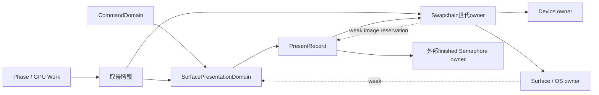

# Presentの完了観測と世代保持

順序10c。graphicsのCompletionと、presentationに必要な資源の保持を分ける。通常Swapchain／明示SwapchainArenaの両方が、同じ記録・Fence pool・回収処理を使う。AcquireTicket、frame別acquire Fence、取得後の失敗処理、AHOの復旧は10d／10eへ続く。

## 4責務

| 層 | 今回の役割 |
| --- | --- |
| storage | 実画像数MからImage slotと、strict時のFence slotのoffset／容量を計算する |
| operation | 解決済みnative Queue／Swapchain／Semaphore／Fenceでpresent・poll・waitする |
| sync | enqueue結果、保存済みPresentState／FenceProof、成功と失敗の終端を管理する |
| lifetime | 外部Domain、Record、世代とSemaphoreの保持、snapshot回収、終了時の退避を管理する |

通常の操作は解決済みImpl／native handleへ直接届く。Domainの一覧探索は取得・present・wait_idle・終了の境界に限定する。公開Completionの意味をpresentation完了へ変更しない。

## 所有方向



SurfaceごとにDomainを共有し、別CommandDomainの新世代取得でも旧世代を回収できる。Domain自身はSurfaceを弱参照し、空のregistryだけではWindowを延命しない。世代内部はRecordを強所有しない。Recordの外部Semaphoreが同じ世代ownerなら、重複保持を省く。

最後のDomain参照が外れた後も、destructor中はSurface contextのidentityを維持する。解放callbackによる同Surfaceへの再attachは拒否し、破棄処理の終了後にだけ解除する。Window／Surface操作の外部直列化が前提であり、VSL全体のthread safetyを追加するものではない。

## CPU配置とFence再利用

`SwapchainLayout(M, REQUIRE_FENCE)`は、画像slotの後にFence slotを一つ追加する。共通backendでFenceImplを指定領域へ構築し、native FenceをM個用意する。生成順はImage群→Fence群→Swapchain採用、rollbackは成功済みの逆順とする。LEGACYにはpresent Fenceを追加しない。

同じ画像slotの次のpresentは、前Recordの完了を保存してからFenceをresetする。PENDING／UNCERTAIN予約中の再利用を拒否する。slotのepochと実体identityで、準備中の再入や古いRecordのenqueueを拒否する。terminalを保存したRecordは、再利用後のFenceを再観測しない。

今回のCPU領域にはImplとslot状態を含む。native Fence配列、画像予約表のvector、PresentRecord／AcquireEvidenceのcontrol block、snapshot用vectorは別確保である。Vulkan内部のnative資源確保やデバイスメモリをCPU arenaへ含めたものではない。

## 準備・enqueue・完了

1. Native acquire前にAcquireEvidenceを登録する。実取得世代とindex、前presentのserial／Queueを保存し、acquire Fenceの結果は破棄・再利用前に値へ保存する。
2. Native present前にRecord確保、registry登録、同slot予約、Fence resetを終える。finished markerは準備成功時にRecordへ移譲する。
3. Native present後は追加確保なしで結果とslotを更新する。serialは実attemptごとに採番し、未enqueueのattemptを実present履歴へ混ぜない。
4. syncが証明を観測し、lifetimeが回収対象の全Recordをreleasedにしてownerを局所値へdetachする。
5. registryを整えてから局所ownerを解放する。callbackが新しいRecordを登録したりPhaseを破棄しても、今回のsnapshot外へ処理を広げない。

| Native結果 | 状態と保持 |
| --- | --- |
| SUCCESS／SUBOPTIMAL／OUT_OF_DATE／SURFACE_LOST／FULL_SCREEN_EXCLUSIVE_MODE_LOST | SUBMITTED。enqueueされたFence／待機Semaphoreを保持する |
| HOST／DEVICE OOM | PENDING。未送信Fenceをwaitせず、予約とmarkerを維持し、同Recordでretryできる |
| DEVICE_LOST | FAILED。成功証明とは区別して回収する |
| その他の不明結果 | UNCERTAIN。成功とせず、非blocking観測または別の終端情報まで保持する |

OOM後のsignal消費と画像返却の完全な復旧は10dの対象である。[presentの結果とenqueue契約](https://docs.vulkan.org/refpages/latest/refpages/source/vkQueuePresentKHR.html)

strictでは各Recordの独立したpresent Fenceを使う。graphics FenceやDevice idle成功だけではstrict Recordを完了扱いにしない。present Fenceは関連資源の破棄安全性の証明であり、画面への表示完了ではない。[present Fence](https://docs.vulkan.org/refpages/latest/refpages/source/VkSwapchainPresentFenceInfoKHR.html)

LEGACYでは実acquire Fenceのsignalから同じ画像の前presentを証明する。同Surface／Device／Queueで、別のRETIRED世代より後の実presentをreacquireした証拠も旧世代へ適用できる。実indexの返却だけや、strict present Fenceのsignalだけではこの証明を作らない。最後のLEGACY終了でidleを使う互換解除はLEGACY_RELEASEDとし、厳密な完了とは呼ばない。[Semaphore再利用](https://docs.vulkan.org/guide/latest/swapchain_semaphore_reuse.html)、[世代の回収](https://docs.vulkan.org/samples/latest/samples/api/swapchain_recreation/README.html)

## wait_idleと損失の扱い

wait_idleは開始時のSUBMITTED Workと、同Deviceの非PENDING Record／取得証拠をsnapshotする。terminalだが未回収のRecordも含め、回収用reserve失敗後の次回回収を可能にする。PENDINGとcallbackで追加されたWork／Recordは今回の対象へ加えない。

DeviceLost判明時は、全snapshotの未terminal Work／RecordへFAILEDを先に保存してからownerを解放する。callbackから別snapshotを観測しても、未分類のFenceを成功として公開しない。既に保存した終端結果は上書きしない。同期側の`save_terminal`は結果保存だけ、`finish_submission`が後で保持を一度だけ解除する。

DeviceLost後のFence waitもSUCCESSを返し得るため、既知の損失を再waitの結果で上書きしない。Legacyの取得証拠をpollする前にも損失を適用する。[Fence waitの損失契約](https://docs.vulkan.org/refpages/latest/refpages/source/vkWaitForFences.html)

## 不明結果と終了

enqueue不明の未signal Fenceをdestructorで無限waitしない。証明できないRecordは既存Recordのnext参照を使う非循環quarantineへ退避し、退避時の追加確保を避ける。管理metadataにはプロセス終了時の自動destructorを持たせず、未証明のnative資源を勝手に破棄しない。

回収は呼出し元が外部同期しているcanonical Surface／Deviceに限定する。通常presentでは非blocking pollだけを行い、無関係なSurface／DeviceのFenceを観測しない。DeviceLostの情報は明示wait_idleの実結果から渡す。mutexはlist更新に限定し、ownerのdeleterはlock外で実行する。証明不能なら保持が残る契約であり、通常OOMからの復旧と区別する。

## 公開入口と残る移行

```cpp
vsl::SwapchainCreateInfo info{
    .width = 640, .height = 480,
    .present_fences = vsl::PresentFencePolicy::REQUIRE_FENCE,
};
vsl::lifetime::SwapchainArena arena(device, *surface, info);
auto phase = manager.start_phase<vsl::DefaultPhase>(arena.view());
// 描画コマンドを記録する。
phase.submit();
manager.wait_idle(); // graphicsと、この時点のpresent Recordをそれぞれ待つ。
```

Instance／Device側でmaintenance1を有効化しておく。通常Swapchain constructorへ同じpolicyを渡した場合も同じbackendを使う。公開Phase／Completionの戻り値は維持し、RecordとDomainはprivateである。公開data_、個別acquire Fence、取得情報のshared owner、通常Swapchain生成adapterは移行中の入口として残る。

## 検証

Apple M1／MoltenVK1.4.2、Vulkan validation、ASan／UBSanで実GPUを使う。strict証明未観測の保持、OOM予約とretry、enqueue済みエラー、pool再利用、別DomainのLegacy旧世代回収、Phase自己破棄、終了時再attach拒否、回収callback中の新PENDING／SUBMITTED維持、別Surfaceのquarantine隔離、不明結果の送信前後を検証する。

既知DeviceLostは実native idleとpresent Fenceの待機後に戻り値を注入し、実driverの損失を再現したとは扱わない。batch保存、signal済みLegacy証拠より損失を優先するテスト、全snapshot保存後のcallbackとPENDING維持も確認した。旧順序へ戻した比較では、損失の分類と通知順の回帰2件が失敗し、修正版は成功した。

- 追加16件、全VSL1,056件、AHO GPU159件／CPU1,070件、コンパイル契約195件が成功。従来driver制約のpacked clear3件だけskip、新規skipなし。LSanは無効。
- 全変更21ファイル／11TUはformat2件だけで、comment／空白修正後の補足2ファイル／2TUは違反0。source368件の違反0、CMake／MSBuild／filtersへ新製品6pathを一意登録した。
- host Swapchain Impl／slotは168 byte、Surface Impl56／slot128、alignment8。実定義との一致、install consumer26target、Debug／Release、x86_64 compile-only／archive、artifact混在と直接Arena constructorのlink拒否、借用の負例を確認した。新しいprivate状態／operation／lifetimeヘッダーはinstallしない。
- heap／arenaは3frame／12submission／2drawとresizeを通し、互換Pipeline生成1回、PNG3枚が対応ごと一致した。

追加ウィンドウのcloseを忘れた初期テストは、case成功後にInstance破棄が遅れ、破棄済fixtureへvalidation callbackが戻って異常終了した。テストをRAIIで閉じる形へ修正し、caseだけでなくプロセス終了コードまで確認した。他OS、実OOM／DeviceLost、複数queue family実機は未検証。性能改善率は未測定。
